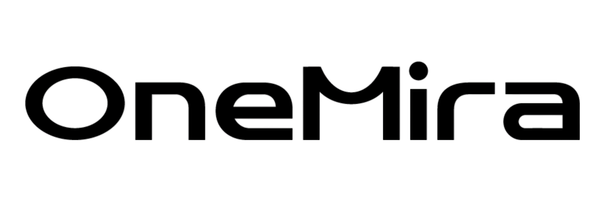

<div align="center">

  <br />
  
  <br />
  <br />

  <h3>Bring Intelligence Into the Real World</h3>

  <p>
    <a href="https://github.com/onemira-space"></a>
    <a href="https://onemira.com"></a>
    <a href="#core-engineering-pillars"></a>
    <a href="https://onemira.com"></a>
  </p>

  <br />

</div>

## Overview

OneMira is dedicated to bridging autonomous AI systems with physical human environments. We research, build, and deploy embodied robotics, ambient context memory engines, edge AI inference runtimes, and spatial web experiences.

---

## Core Engineering Pillars

<table>
  <tr>
    <td width="50%" valign="top">
      <h3>Context & Ambient Intelligence</h3>
      <p>Core context engine, meeting memory, and native ambient interfaces.</p>
      <ul>
        <li><strong><a href="https://github.com/onemira-space/mira-context">mira-context</a></strong>: Core context & meeting memory intelligence engine.</li>
        <li><strong><a href="https://github.com/onemira-space/miramem-mac">miramem-mac</a></strong>: Native macOS client application.</li>
        <li><strong><a href="https://github.com/onemira-space/ai-run-bar">ai-run-bar</a></strong>: Ambient agent status bar for power AI users.</li>
      </ul>
    </td>
    <td width="50%" valign="top">
      <h3>Embodied AI & Robotics</h3>
      <p>Physical hardware integration, kinematics, and low-power motor control.</p>
      <ul>
        <li><strong><a href="https://github.com/onemira-space/miralamp-runtime">miralamp-runtime</a></strong> / <strong><a href="https://github.com/onemira-space/miralamp">miralamp</a></strong>: Real-time interactive smart desk robot with perception and motion control.</li>
        <li><strong><a href="https://github.com/onemira-space/lamp-kinematics">lamp-kinematics</a></strong>: 5-DOF motion generation and inverse kinematics algorithms.</li>
        <li><strong><a href="https://github.com/onemira-space/tmc2209-rs">tmc2209-rs</a></strong>: Low-power 2-phase stepper motor driver written in Rust.</li>
      </ul>
    </td>
  </tr>
  <tr>
    <td width="50%" valign="top">
      <h3>Edge Intelligence & LLM</h3>
      <p>High-efficiency LLM inference runtimes optimized for embedded NPU accelerators.</p>
      <ul>
        <li><strong><a href="https://github.com/onemira-space/mira-llm">mira-llm</a></strong>: Deeply optimized LLM runtime for Rockchip RK3588 and RK3576 platforms.</li>
        <li><strong><a href="https://github.com/onemira-space/onnx_to_rknn">onnx_to_rknn</a></strong>: Containerized toolchain for ONNX to RKNN model exporting.</li>
        <li><strong><a href="https://github.com/onemira-space/llm-go">llm-go</a></strong>: High-performance Go client for cloud and local model routing.</li>
      </ul>
    </td>
    <td width="50%" valign="top">
      <h3>Web, Storefront & Media</h3>
      <p>Storefront infrastructure, programmatic media rendering, and spatial web graphics.</p>
      <ul>
        <li><strong><a href="https://github.com/onemira-space/shopify-hydrogen">shopify-hydrogen</a></strong>: OneMira official storefront built with Shopify Hydrogen framework.</li>
        <li><strong><a href="https://github.com/onemira-space/onemira-remotion">onemira-remotion</a></strong>: Programmatic video generation and motion graphics rendering engine.</li>
        <li><strong><a href="https://github.com/onemira-space/onemira-threejs">onemira-threejs</a></strong>: Interactive 3D product visualizations and web graphics.</li>
        <li><strong><a href="https://github.com/onemira-space/onemira-updates">onemira-updates</a></strong>: Desktop application distribution center and Sparkle appcast feed.</li>
      </ul>
    </td>
  </tr>
</table>

---

## Technical Architecture

```
[ Multimodal Sensors & Perception ] ---> [ Core Context Engine (mira-context) ]
                                                       |
                                                       v
[ Edge NPU Accelerator (mira-llm) ] <--- [ Local Memory & State (miramem-mac) ]
                                                       |
                                                       v
[ Desk Robot & Kinematics (tmc2209-rs) ] <--- [ Hardware Control Pipeline ]
```

---

## Contact & Information

- **Website**: [onemira.com](https://onemira.com)
- **Contact Email**: [pengjunhao@onemira.com](mailto:pengjunhao@onemira.com)
- **Organization GitHub**: [github.com/onemira-space](https://github.com/onemira-space)
